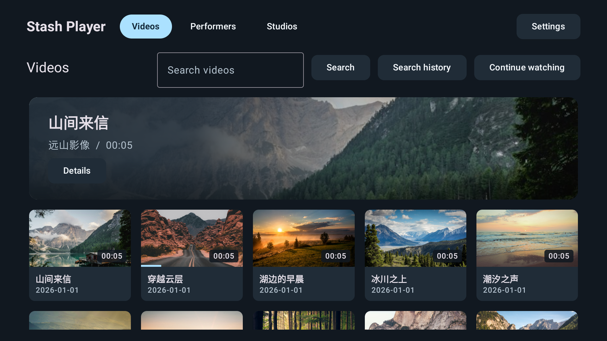
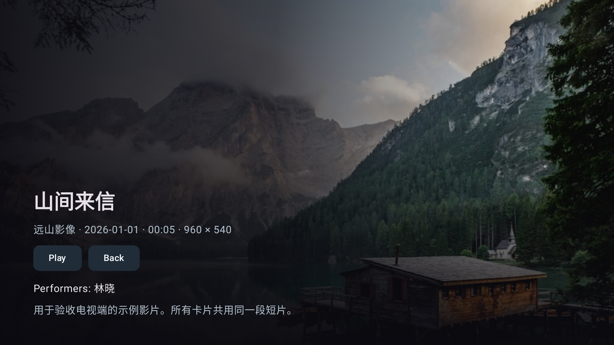
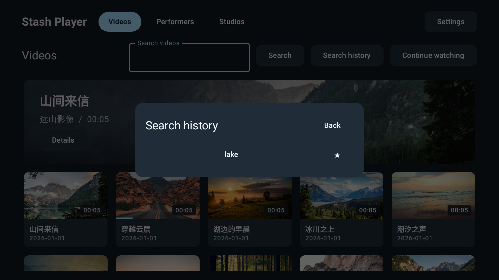
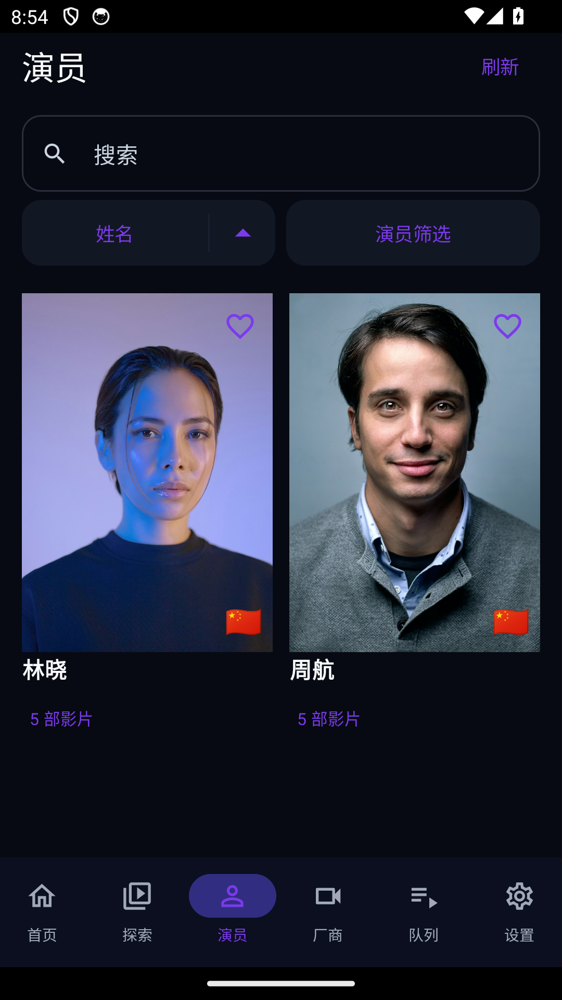
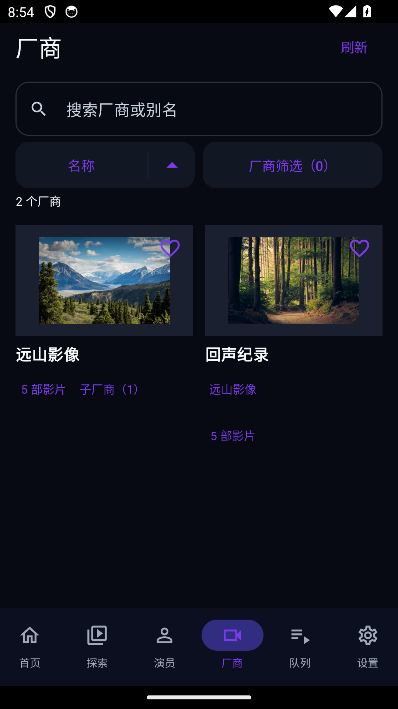
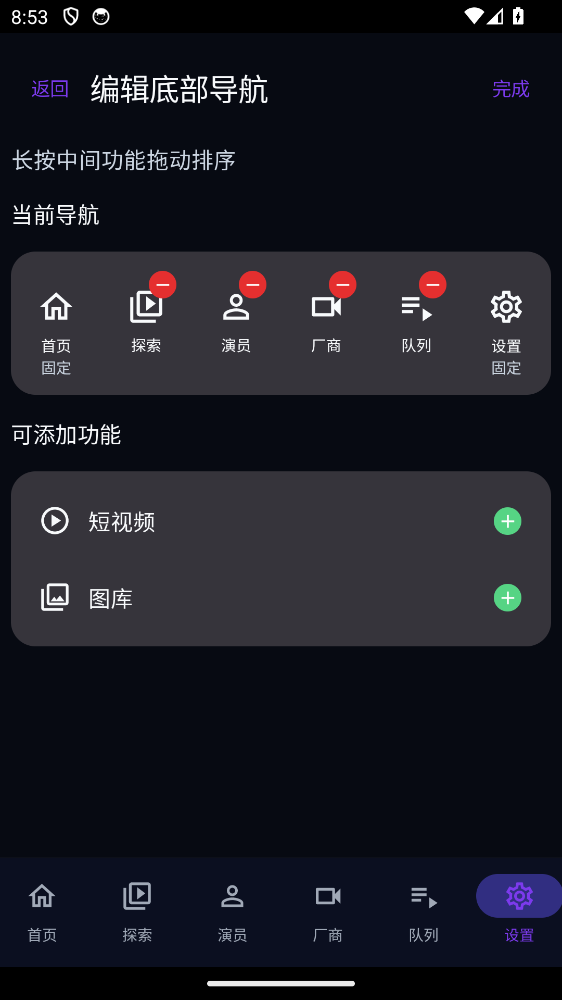

# Stash Android Player · LZCY 에디션

**휴대폰에서는 출연자와 스튜디오별로 영상을 찾고, Android TV에서는 리모컨으로 같은 Stash 라이브러리를 둘러보고 재생하거나 이어보세요.**

LZCY 에디션은 [Stash Android Player 원본 프로젝트](https://github.com/gomeng-dev/stash-player-android)를 기반으로 합니다. Android TV 전용 앱을 추가하고 휴대폰의 탐색 및 재생 기능을 개선했습니다. 두 앱 모두 사용자의 Stash 서버에 직접 연결됩니다.

[휴대폰용 다운로드](https://github.com/lzcy1326/stash-player-android/releases/tag/phone-v1.14.1-lzcy1.6.0) · [Android TV용 다운로드](https://github.com/lzcy1326/stash-player-android/releases/tag/tv-v1.14.1-lzcy1.6.0) · [전체 릴리스](https://github.com/lzcy1326/stash-player-android/releases)

[English](README.md) · [简体中文](README.zh-CN.md) · [繁體中文](README.zh-TW.md)

## LZCY 에디션에서 달라진 점

### Android TV 전용 앱

- **리모컨으로 라이브러리 탐색.** 영상, 출연자, 스튜디오 탭에서 각각 검색하고 상세 정보와 관련 영상을 볼 수 있습니다. 영상 홈과 상세 화면에는 큰 배경 이미지가 표시됩니다. 화면의 열 수에 맞춰 목록을 나누며, 재생을 종료하면 원래 영상 카드로 포커스가 돌아갑니다.
- **방향키로 재생 위치 이동.** 좌우 방향키를 짧게 누르면 앞뒤로 이동하고, 길게 누르면 재생 위치와 Stash 썸네일 미리보기를 확인할 수 있습니다. 영상 탭에서 이어볼 수 있으며 검색 기록에서 다시 검색하거나 자주 쓰는 검색어에 별표를 표시할 수 있습니다.
- **휴대폰으로 QR 코드 페어링.** Stash에 연결된 휴대폰 앱으로 TV의 QR 코드를 스캔하고 확인하면 서버 설정을 전송할 수 있습니다.
- **공용 TV에서 PIN 설정.** 네 자리 PIN을 설정하면 앱을 실행하거나 다시 열 때 PIN 확인이 필요합니다.

아래 스크린샷은 데모 라이브러리로 촬영했습니다. TV 화면은 영어, 휴대폰 화면은 중국어 간체로 표시됩니다.

  
   Android TV 영상 홈

| 영상 상세 정보 | 검색 기록과 별표 |
| --- | --- |
|  |  |

### 휴대폰의 탐색 및 재생 개선

- **출연자와 스튜디오 전용 페이지.** 검색, 필터, 정렬을 지원하며 상세 페이지에서 관련 영상을 둘러보고 재생할 수 있습니다. 출연자와 스튜디오의 즐겨찾기 및 평점은 Stash에 동기화할 수 있습니다. 스튜디오의 영상 목록에 하위 스튜디오의 영상도 포함할 수 있습니다.
- **하단 탭 맞춤 설정.** 기본 탭은 홈, 탐색, 출연자, 스튜디오, 대기열, 설정입니다. 설정 → 인터페이스 → 하단 탐색 메뉴에서 탭을 추가하거나 끌어서 순서를 바꿀 수 있습니다. 쇼츠와 갤러리도 다시 추가할 수 있습니다.
- **홈에서 새 콘텐츠 확인.** 이어보기 아래에서 최근 공개된 영상, 최근 추가된 출연자와 스튜디오를 볼 수 있습니다. 영상 카드에는 품번과 공개일이 표시됩니다.
- **가로 및 세로 화면의 재생 조작 개선.** 가로 화면의 밝기와 음량 제스처, 탐색 미리보기, 플레이어 조작을 다듬었습니다. 영상을 이어볼 때는 마지막 재생 위치가 표시되며 처음부터 재생할 수도 있습니다.

| 출연자 탐색 | 스튜디오 탐색 | 하단 탭 편집 |
| --- | --- | --- |
|  |  |  |

### 더 읽기 쉬운 중국어 간체 번역

탐색, 갤러리, 플레이어, 설정에서 중국어 간체로 표시되는 필터와 재생 상태, 안내 문구를 다듬었습니다. 예를 들어 화면 방향은 ‘景观 / 肖像’에서 ‘横屏 / 竖屏’(가로 / 세로)으로, 갤러리의 출연자 항목은 ‘表演者’에서 ‘演员’(출연자)으로, 플레이어의 음량 표시는 ‘卷’에서 ‘音量’(음량)으로 바꿨습니다.

## 다운로드 및 설치

휴대폰용과 TV용 APK를 별도로 제공하며 현재 버전은 모두 **`1.14.1-lzcy1.6.0`**입니다. 버전별 변경 사항은 [변경 기록](CHANGELOG.md)을 참고하세요.

| 기기 | 릴리스 |
| --- | --- |
| Android 휴대폰 또는 태블릿 | [휴대폰용 APK](https://github.com/lzcy1326/stash-player-android/releases/tag/phone-v1.14.1-lzcy1.6.0) |
| Android TV | [TV용 APK](https://github.com/lzcy1326/stash-player-android/releases/tag/tv-v1.14.1-lzcy1.6.0) |

- **휴대폰.** 휴대폰용 APK를 다운로드한 뒤 열어서 설치합니다. 같은 키로 서명된 LZCY 버전은 기존 앱 위에 업데이트할 수 있습니다. 패키지 이름이 같고 서명 키가 다른 원본 앱이 설치되어 있다면 데이터를 먼저 백업한 뒤 원본 앱을 제거하고 LZCY 에디션을 설치하세요.
- **TV.** 기기에서 지원하는 방식으로 TV용 APK를 설치합니다. 같은 키로 서명된 LZCY TV 버전은 기존 앱 위에 업데이트할 수 있습니다. 초기 TV 프리뷰는 패키지 이름이 다르므로 정식 버전으로 전환한 뒤 서버를 다시 설정해야 합니다.

Android 10 이상과 기기에서 접속할 수 있는 Stash 서버가 필요합니다. 미디어, 검색 결과, 라이브러리 목록은 사용자의 서버에서 가져옵니다.

## 처음 연결하기

1. 휴대폰 또는 TV에서 Stash Player를 열고 기기에서 접속할 수 있는 Stash 주소를 입력합니다. 예를 들어 `http://192.168.0.10:9999`를 입력합니다.
2. 서버에 맞는 인증 방식을 선택합니다. 휴대폰은 인증 없음, API 키, Stash 사용자 이름과 비밀번호를 지원합니다. TV에서는 서버 주소와 API 키를 직접 입력하거나 휴대폰에서 설정을 받을 수 있습니다.
3. 연결을 테스트하고 성공하면 저장합니다. QR 코드로 페어링할 때는 두 기기를 같은 로컬 네트워크에 연결하고 휴대폰에서 전송을 확인합니다.

휴대폰 스크린샷 더 보기

일부 스크린샷은 이전 버전에서 촬영했습니다. 하단 탭은 설치한 버전과 사용자 설정에 따라 달라질 수 있습니다.

  
  
  

  
  
  

  
  

## 그 밖의 기능

- 휴대폰의 탐색 화면에서 검색, 필터, 정렬, 무작위 재생, 일괄 선택을 이용하고 자주 쓰는 필터를 저장할 수 있습니다.
- 휴대폰에서 재생 대기열을 최대 10개 저장하고 진행 상태를 복원할 수 있습니다. 검색창에는 최근 검색어 50개까지 표시되며 별표를 붙인 검색어는 이 한도에 포함되지 않습니다.
- 휴대폰 플레이어는 제스처 탐색, 길게 눌러 배속 재생, 스트림 선택, 자막, 조작 잠금, 화면 속 화면을 지원합니다.
- 휴대폰에서 쇼츠, 갤러리, 이미지를 둘러보고 나중에 보기, 기기 내 즐겨찾기, 재생 기록을 이용할 수 있습니다.

## 개인정보 및 사용 안내

- 서버 설정, 기기 내 목록, 검색 기록은 기기에 저장됩니다. 앱은 사용자의 Stash 서버에 직접 연결되고 별도의 프로젝트 계정이 필요하지 않습니다. 라이브러리 메타데이터를 이 프로젝트로 전송하지 않습니다.
- 출연자와 스튜디오의 즐겨찾기 및 평점은 Stash에 저장됩니다. 기기 내 영상 목록, 영상 즐겨찾기, 검색어는 각각의 기기에 저장됩니다.
- 탐색 썸네일을 보려면 Stash에서 미리보기 이미지가 생성되어 있어야 합니다. 미리보기 이미지가 없어도 재생 위치를 옮길 수 있습니다.
- 영상 삭제 대화 상자에서는 원본 파일 삭제가 기본으로 선택됩니다. 원본 파일을 보관하려면 삭제를 확인하기 전에 해당 선택을 해제하세요. 삭제 확인 팝업 생략 옵션은 기본적으로 꺼져 있습니다. 켜면 한 개 또는 여러 개의 영상을 삭제할 때 원본 파일까지 즉시 삭제됩니다.

## 피드백 및 개발

[문제 신고](https://github.com/lzcy1326/stash-player-android/issues) · [개발 안내](DEVELOPMENT.md) · [휴대폰 및 TV 릴리스 정책](FORK_VERSIONING.md)

이 프로젝트는 [MIT 라이선스](LICENSE)를 따릅니다.
