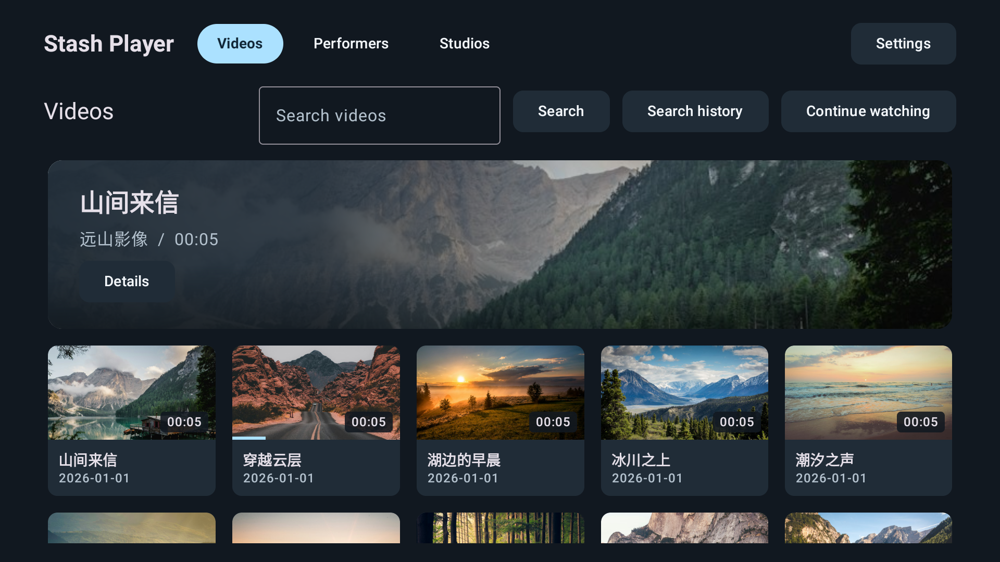
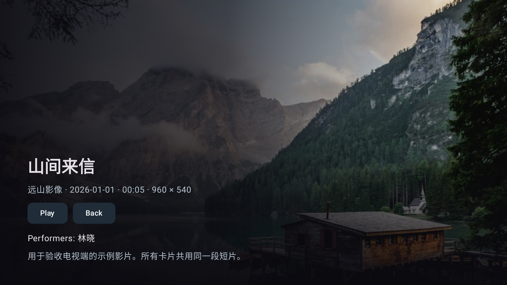
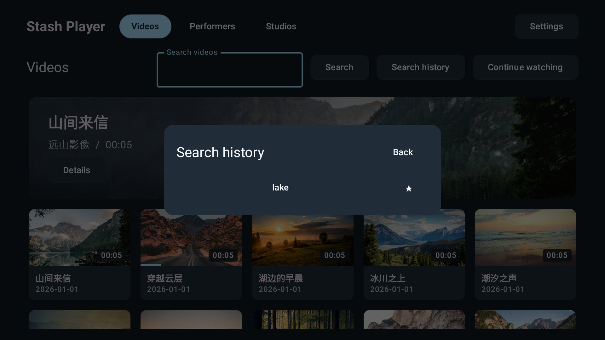
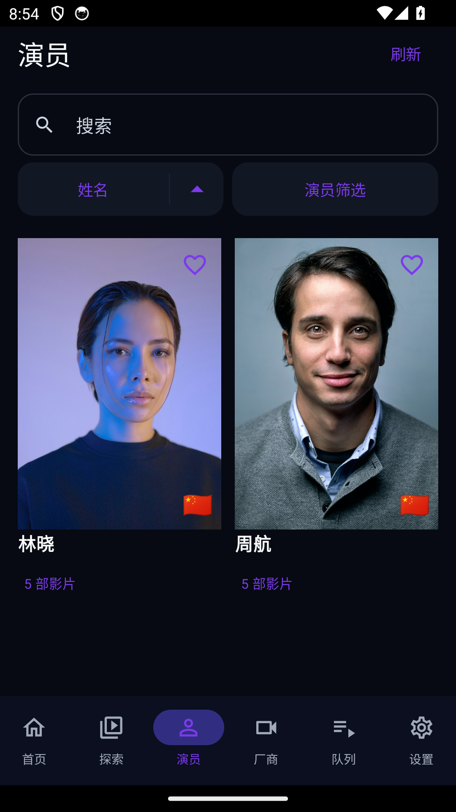
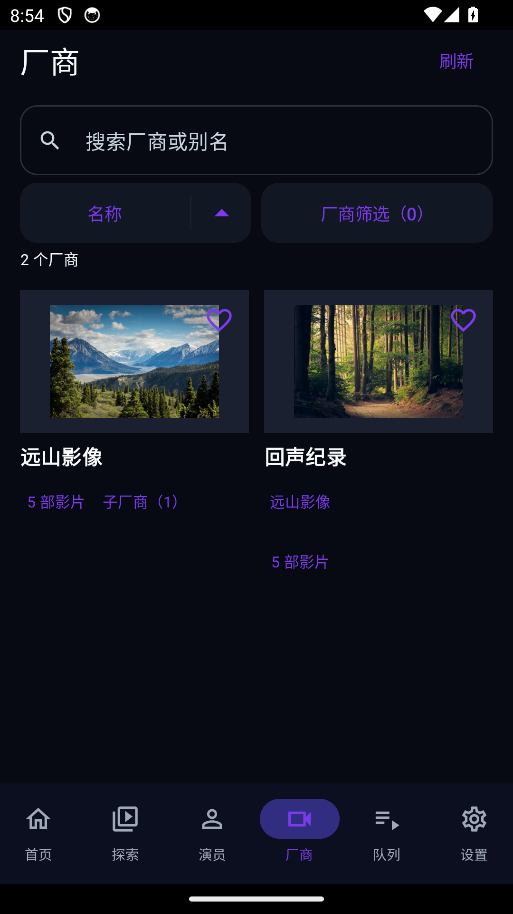
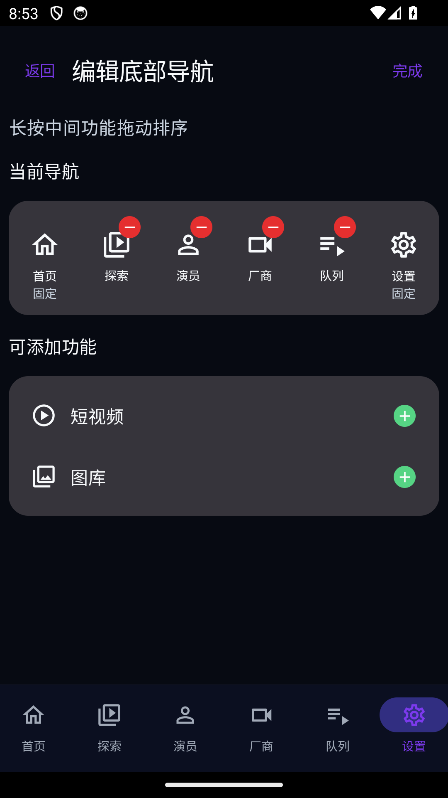

# Stash Android Player · LZCY Edition

**Browse your Stash library by performer or studio on your phone, then browse, play, and resume on Android TV with a remote.**

The LZCY edition is based on the [upstream Stash Android Player project](https://github.com/gomeng-dev/stash-player-android). It adds a dedicated Android TV app and improves browsing and playback on phones. Both apps connect directly to your own Stash server.

[Download for Android phones](https://github.com/lzcy1326/stash-player-android/releases/tag/phone-v1.14.1-lzcy1.6.0) · [Download for Android TV](https://github.com/lzcy1326/stash-player-android/releases/tag/tv-v1.14.1-lzcy1.6.0) · [All releases](https://github.com/lzcy1326/stash-player-android/releases)

[简体中文](README.zh-CN.md) · [繁體中文](README.zh-TW.md) · [한국어](README.ko.md)

## What's different in the LZCY edition?

### Dedicated Android TV app

- **Browse with your remote.** Videos, performers, and studios have their own tabs, with search, detail pages, and related videos. The video home and detail pages use large backdrops. Lists adapt to the number of columns, and exiting playback returns focus to the original video card.
- **Find your place with the D-pad.** Tap left or right to seek. Hold to preview the timeline with Stash thumbnails. The video tab offers Continue Watching, and search history lets you rerun or star a query.
- **Pair with your phone.** Scan the QR code on the TV with the phone app and confirm to send your server settings. The phone must already be connected to Stash.
- **Set a PIN on a shared TV.** A four-digit PIN can protect the app when it opens or returns to the foreground.

The screenshots use a demo library. The TV app is shown in English and the phone app in Simplified Chinese.

  
   Android TV video home

| Video details | Search history and starred queries |
| --- | --- |
|  |  |

### Easier browsing and playback on phones

- **Dedicated performer and studio pages.** Search, filter, and sort, then open a profile to browse and play related videos. Performer and studio favorites and ratings can sync to Stash. Studio browsing can include videos from child studios.
- **Customizable bottom navigation.** Home, Explore, Performers, Studios, Queue, and Settings are available by default. Add or reorder shortcuts in Settings → Interface → Bottom navigation. Shorts and Gallery can be added back.
- **More to discover on Home.** Below Continue Watching, see recently released videos and recently added performers and studios. Video cards show the catalog code and release date.
- **Refined playback controls.** Landscape brightness and volume gestures, seek previews, and player controls have been adjusted. When a video resumes, the player shows the saved position and offers Start from Beginning.

| Performers | Studios | Bottom navigation editor |
| --- | --- | --- |
|  |  |  |

### Clearer Simplified Chinese

Explore, Gallery, the player, and Settings have revised Simplified Chinese labels and prompts. For example, the orientation labels changed from “景观 / 肖像” to “横屏 / 竖屏” (landscape / portrait), the gallery filter changed from “表演者” to “演员” (performers), and the player changed from “卷” to “音量” (volume).

## Download and install

The phone and TV apps are published as separate APKs. Both are currently on **`1.14.1-lzcy1.6.0`**. See the [changelog](CHANGELOG.md) for version details.

| Device | Release |
| --- | --- |
| Android phone or tablet | [Phone APK](https://github.com/lzcy1326/stash-player-android/releases/tag/phone-v1.14.1-lzcy1.6.0) |
| Android TV | [TV APK](https://github.com/lzcy1326/stash-player-android/releases/tag/tv-v1.14.1-lzcy1.6.0) |

- **Phone.** Download the phone APK and open it to install. You can update a LZCY release signed with the same key in place. If you have an upstream build with the same package name and a different signing key, back up your data, then uninstall the upstream app before installing the LZCY edition.
- **TV.** Install the TV APK using a method supported by your device. You can update a LZCY TV release signed with the same key in place. The early TV preview used a different package name, so you'll need to set up the server again when switching from that preview.

Both apps require Android 10 or later and a Stash server the device can reach. Your server supplies the media, search results, and library listings.

## First connection

1. Open Stash Player on your phone or TV and enter a Stash URL the device can reach, such as `http://192.168.0.10:9999`.
2. Choose the authentication method required by your server. The phone supports no authentication, an API key, or Stash username and password. On TV, enter the server address and API key manually or receive the setup from your phone.
3. Test the connection and save the settings. To pair by QR code, connect both devices to the same local network and confirm on the phone.

More phone screenshots

Some screenshots show earlier versions. The bottom navigation depends on your installed version and settings.

  
  
  

  
  
  

  
  

## Other features

- Explore supports search, filters, sorting, shuffle, batch selection, and saved filters.
- The phone saves up to 10 playback queues and can restore their progress. Phone search shows the 50 most recent queries, excluding starred queries from the limit.
- The phone player supports gesture seeking, hold-to-speed-up, stream selection, subtitles, control lock, and picture-in-picture.
- On the phone you can also browse Shorts, Gallery, and Images, and use Watch Later, local favorites, and playback history.

## Privacy and usage notes

- Server settings, local lists, and search history are stored on the device. The app connects directly to your Stash server and works without a project account. It does not upload library metadata to this project.
- Performer and studio favorites and ratings are written to Stash. Local video lists, video favorites, and search queries stay on the device where they were saved.
- Seek thumbnails require previews generated by Stash. Time-based seeking works without them.
- The video deletion dialog selects original file deletion by default. Clear that option before confirming if you want to keep the original files. Skip delete confirmation is off by default. Enabling it deletes immediately, including original files, for individual and batch deletions.

## Feedback and development

[Report an issue](https://github.com/lzcy1326/stash-player-android/issues) · [Development guide](DEVELOPMENT.md) · [Phone and TV release policy](FORK_VERSIONING.md)

The project is available under the [MIT license](LICENSE).
