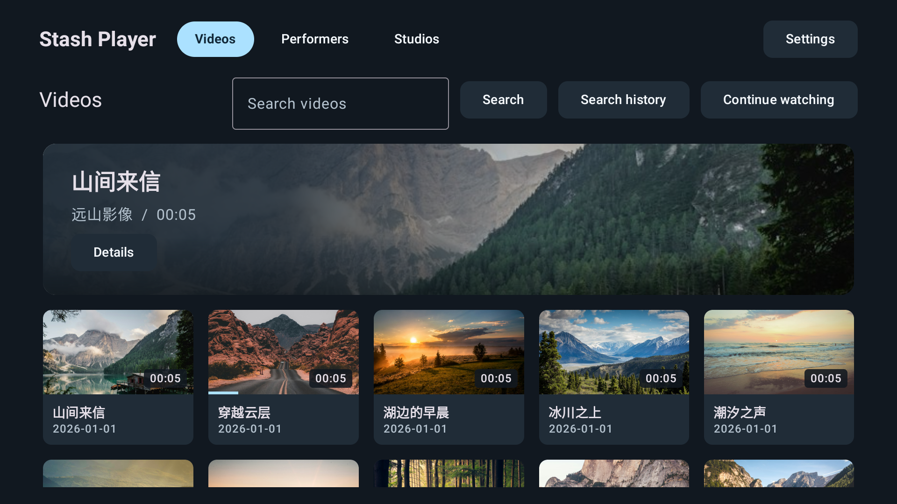
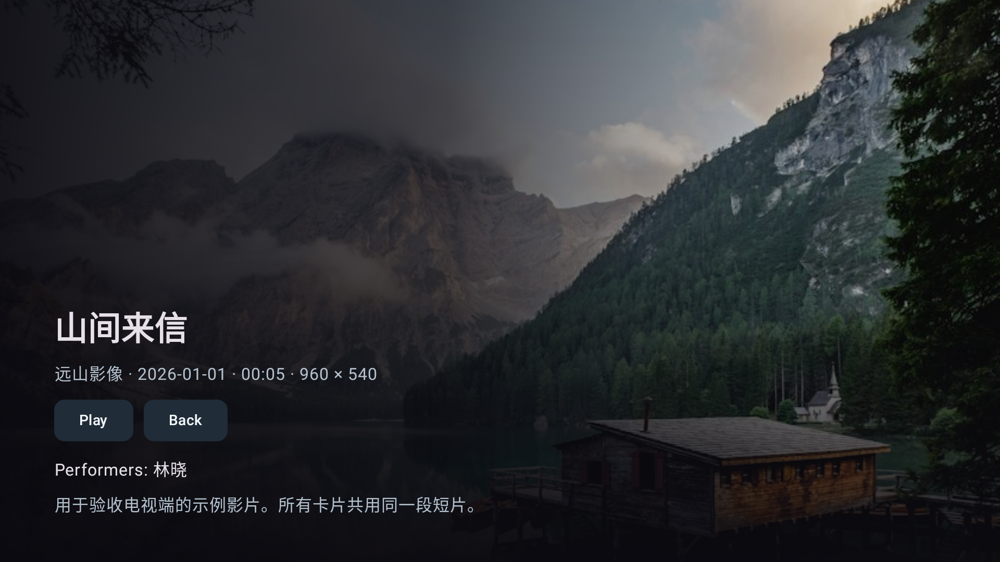
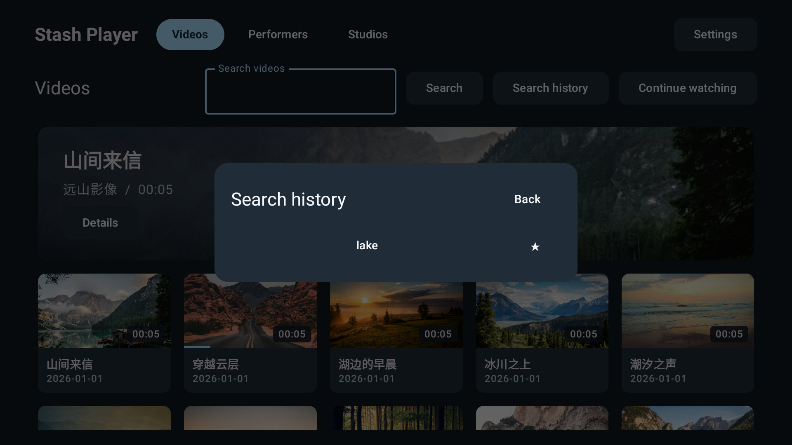
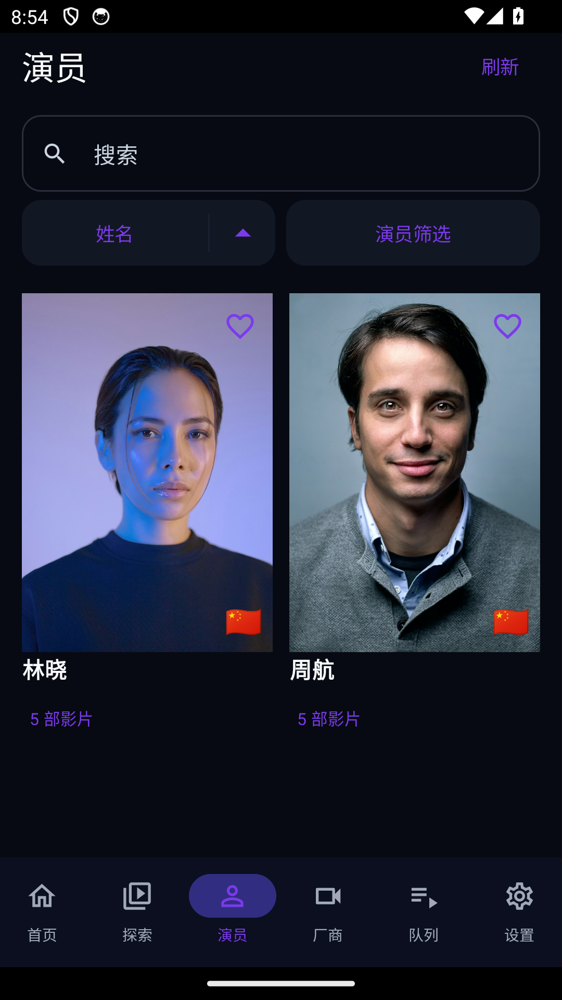
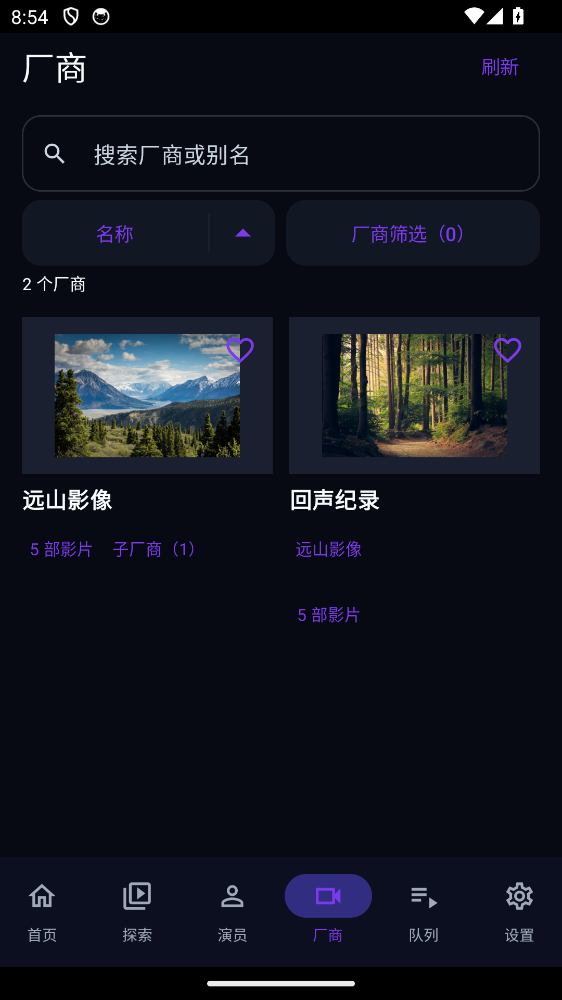
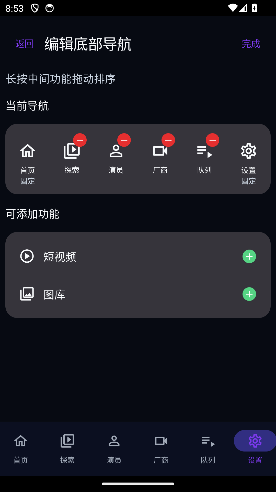

# Stash Android Player · LZCY 个人版

**在手机上按演员和厂商找片，在电视上用遥控器浏览、播放和续看同一个 Stash 媒体库。**

LZCY 个人版基于 [Stash Android Player 上游项目](https://github.com/gomeng-dev/stash-player-android)，保留原生 Android 客户端的核心功能，增加独立的 Android TV 版，并改进手机端的浏览和播放体验。手机和电视都直接连接你自己的 Stash 服务器。

[下载手机版](https://github.com/lzcy1326/stash-player-android/releases/tag/phone-v1.14.2-lzcy1.6.2) · [下载电视版](https://github.com/lzcy1326/stash-player-android/releases/tag/tv-v1.14.1-lzcy1.6.0) · [全部发行版本](https://github.com/lzcy1326/stash-player-android/releases)

[English](README.md) · [한국어](README.ko.md) · [繁體中文](README.zh-TW.md)

## 相比上游，个人版有哪些改进？

### 独立 Android TV 版

- **用遥控器逛片库。** 影片、演员和厂商都有独立入口，可以搜索、查看详情、浏览关联影片。大屏首页和影片详情展示大幅背景图，列表按屏幕列数分页，退出播放后回到原影片卡片。
- **用遥控器找准播放位置。** 左右键短按跳转，长按查看进度和 Stash 缩略图预览。影片页支持继续观看，也可以从搜索历史重新搜索或收藏常用搜索词。
- **手机扫码配对。** 电视显示二维码后，用已经连好 Stash 的手机版扫码确认，即可发送服务器配置，省去用遥控器手输地址和密钥。
- **共享电视可启用 PIN。** 设置四位 PIN 后，启动或返回应用时需要验证。

截图均使用演示片库。电视画面为英文界面，手机画面为简体中文界面。

  
   电视影片首页

| 影片详情 | 搜索历史与星标收藏 |
| --- | --- |
|  |  |

### 手机端更方便找片和播放

- **演员和厂商有独立浏览页。** 支持搜索、筛选和排序，可从资料页直接浏览并播放关联影片。支持同步演员和厂商的收藏、评分到 Stash，浏览厂商影片时也可包含子厂商。
- **底部导航按习惯排列。** 默认提供首页、探索、演员、厂商、队列和设置。可以在「设置 → 界面 → 底部导航」选择常用入口并拖动排序，短视频和图库也可以加回。
- **首页更容易发现新内容。** 续播卡片下可浏览最近发布的影片、最近添加的演员和厂商。影片卡片显示番号和发行日期，扫一眼就能区分条目。
- **优化横竖屏的播放操作。** 调整了横屏亮度和音量手势、进度预览和播放器控件；从上次进度开始播放时，会显示续播位置和「从头播放」入口。

| 演员浏览 | 厂商浏览 | 底部导航编辑 |
| --- | --- | --- |
|  |  |  |

### 简体中文界面更好读

重新梳理了探索、图库、播放器和设置里的简体中文文案，让筛选条件、播放状态和操作提示更容易看懂。比如图片方向从「景观 / 肖像」改为「横屏 / 竖屏」，图库里的「表演者」改为「演员」，播放器音量提示从「卷」改为「音量」。

## 下载与安装

手机和电视分别发布独立 APK。手机正式版为 **`1.14.2-lzcy1.6.2`**，电视正式版为 **`1.14.1-lzcy1.6.0`**。详细改动见 [更新日志](CHANGELOG.md)。

| 设备 | 发行页 |
| --- | --- |
| Android 手机或平板 | [手机版 APK](https://github.com/lzcy1326/stash-player-android/releases/tag/phone-v1.14.2-lzcy1.6.2) |
| Android TV | [电视版 APK](https://github.com/lzcy1326/stash-player-android/releases/tag/tv-v1.14.1-lzcy1.6.0) |

- **手机**：下载手机版 APK 后打开安装。已安装同一签名的 LZCY 手机正式版可以覆盖更新。若已安装使用不同签名的同包名上游版，先备份数据，再卸载上游版并安装个人版。
- **电视**：使用设备支持的 APK 安装方式安装电视包。已安装同一签名的电视正式版可以覆盖更新。早期 TV MVP 预览版使用不同包名，切换到正式版后需重新配置服务器。

需要 Android 10 或更高版本，以及设备能访问的 Stash 服务器。搜索、列表和媒体均通过你的服务器提供。

## 首次连接

1. 在手机或电视上打开 Stash Player，输入设备可访问的 Stash 地址，例如 `http://192.168.0.10:9999`。
2. 选择服务器使用的认证方式。手机版支持无认证、API Key 或用户名和密码登录。电视可手动填写地址和 API Key，也可接收手机发送的配置。
3. 测试连接，成功后保存设置。电视扫码时，请让两台设备连接同一局域网，并在手机上确认发送。

更多手机版截图

部分截图来自早期版本，底部导航以安装版本和个人设置为准。

  
  
  

  
  
  

  
  

## 其他常用功能

- 手机「探索」支持搜索、筛选、排序、随机播放和批量选择，也能保存常用筛选条件。
- 手机「队列」可保存最多 10 个播放队列并恢复进度。手机搜索框显示最近 50 条搜索词，收藏不计入上限。
- 手机播放器支持手势定位、长按倍速、播放源切换、字幕、锁定和画中画。
- 手机还可浏览短视频、图库和图片，并使用「稍后观看」、本地收藏和播放历史。

## 隐私与使用说明

- 服务器配置、本地列表和搜索历史保存在设备上。应用直接连接你的 Stash 服务器，无需注册本项目账号，不向本项目上传媒体库元数据。
- 演员和厂商的收藏与评分会写回 Stash。本地影片列表、影片收藏和搜索词保存在各自设备上。
- 缩略图进度预览依赖 Stash 已生成的预览图。没有预览图时仍可按时间定位。
- 删除影片时，确认窗口默认勾选删除原始文件。如需保留原文件，请在确认前取消勾选。「跳过删除确认」默认关闭，开启后单个或批量删除都会立即执行，包含原始文件。

## 反馈与开发

[问题反馈](https://github.com/lzcy1326/stash-player-android/issues) · [开发说明](DEVELOPMENT.md) · [手机与电视发布规则](FORK_VERSIONING.md)

项目采用 MIT 许可证。[查看许可证](LICENSE)
