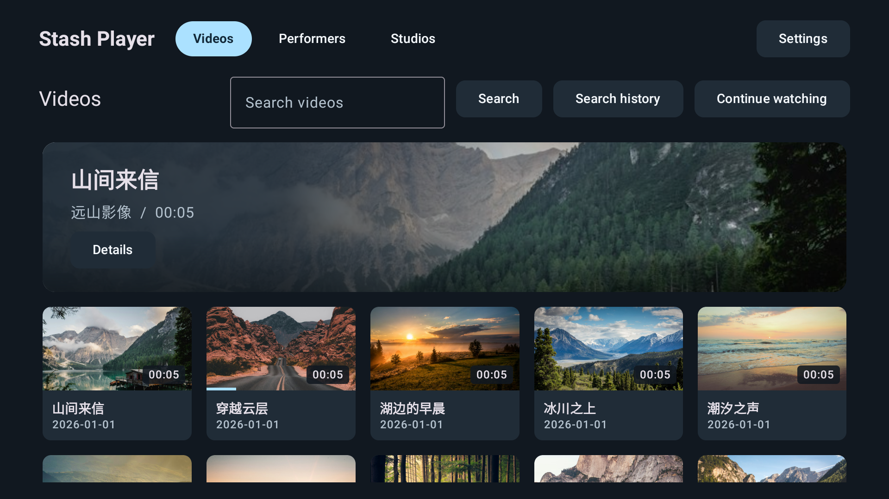
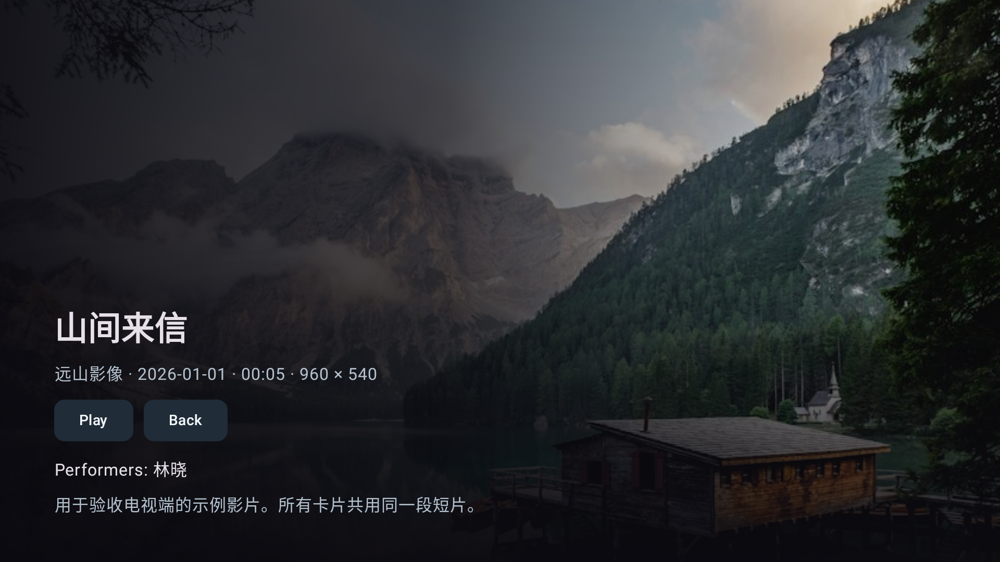
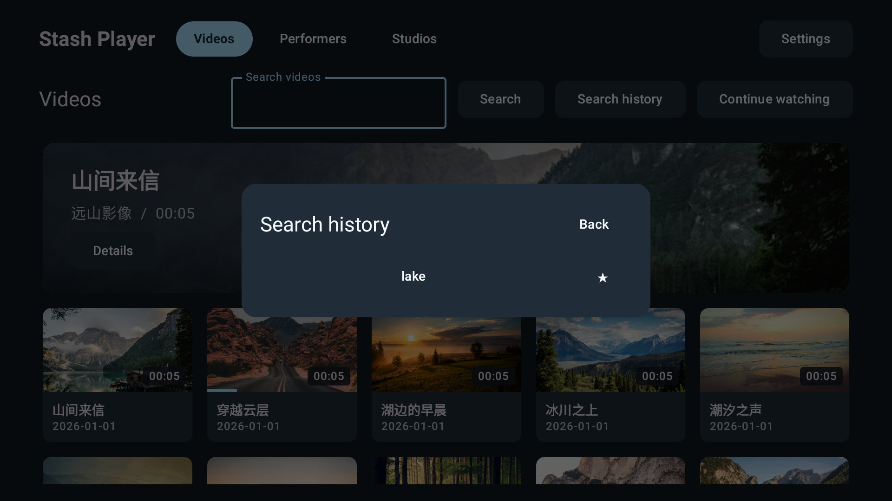
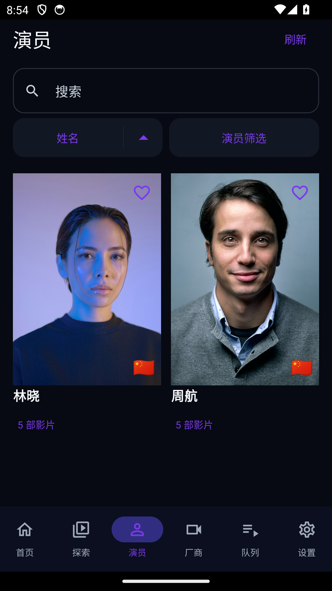
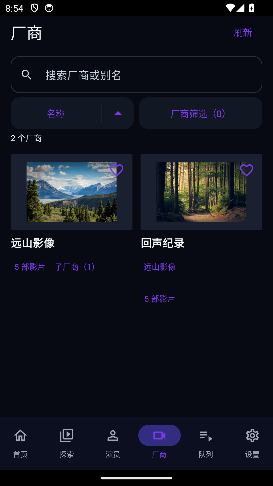
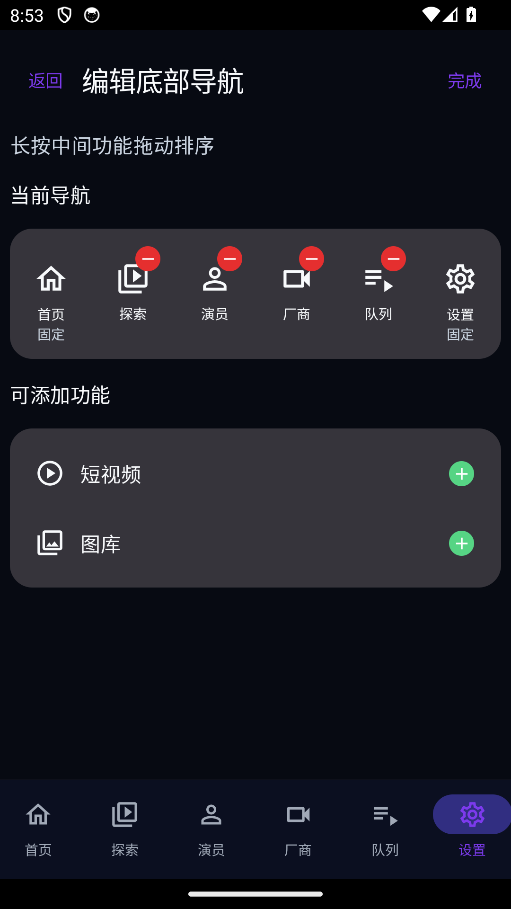

# Stash Android Player · LZCY 個人版

**在手機上依演員和廠商找片，在電視上用遙控器瀏覽、播放與續看同一個 Stash 媒體庫。**

LZCY 個人版基於 [Stash Android Player 上游專案](https://github.com/gomeng-dev/stash-player-android)。它加入獨立的 Android TV 版，也改進了手機端的瀏覽與播放體驗。兩個版本都直接連線到你自己的 Stash 伺服器。

[下載手機版](https://github.com/lzcy1326/stash-player-android/releases/tag/phone-v1.14.1-lzcy1.6.0) · [下載電視版](https://github.com/lzcy1326/stash-player-android/releases/tag/tv-v1.14.1-lzcy1.6.0) · [所有發行版本](https://github.com/lzcy1326/stash-player-android/releases)

[English](README.md) · [简体中文](README.zh-CN.md) · [한국어](README.ko.md)

## 相較於上游，LZCY 個人版有哪些改進？

### 獨立 Android TV 版

- **用遙控器瀏覽媒體庫。** 影片、演員和廠商各有獨立頁籤，可以搜尋、查看詳細資料和瀏覽相關影片。影片首頁與詳細資料頁使用大幅背景，清單會依畫面欄數分頁，離開播放器後焦點會回到原本的影片卡片。
- **用方向鍵定位播放進度。** 短按左右鍵即可快轉或倒轉，長按可檢視進度及 Stash 縮圖預覽。影片頁提供繼續觀看，搜尋紀錄可用來再次搜尋或加上星號收藏。
- **用手機掃描 QR Code 配對。** 使用已連線至 Stash 的手機版掃描電視上的 QR Code，確認後就能傳送伺服器設定。
- **共用電視可啟用 PIN 碼。** 設定四位數 PIN 碼後，啟動或返回應用程式時需要驗證。

以下截圖使用示範媒體庫。電視版以英文介面呈現，手機版以簡體中文介面呈現。

  
   電視版影片首頁

| 影片詳細資料 | 搜尋紀錄與星號收藏 |
| --- | --- |
|  |  |

### 手機上更容易找片與播放

- **演員和廠商各有獨立瀏覽頁。** 支援搜尋、篩選和排序，也能從資料頁瀏覽與播放相關影片。演員與廠商的收藏和評分可同步到 Stash，瀏覽廠商影片時也可納入旗下廠商的影片。
- **依習慣調整底部導覽。** 預設提供首頁、探索、演員、廠商、佇列和設定。可在「設定 → 介面 → 底部導覽」加入常用入口並拖曳排序，短影音和圖庫也能加回。
- **從首頁探索新內容。** 繼續觀看卡片下方可瀏覽最近發行的影片，以及最近新增的演員和廠商。影片卡片顯示番號和發行日期。
- **改進橫向與直向播放操作。** 調整橫向播放時的亮度與音量手勢、進度預覽和播放器控制項。續播時會顯示上次進度，也可以選擇從頭播放。

| 演員瀏覽 | 廠商瀏覽 | 編輯底部導覽 |
| --- | --- | --- |
|  |  |  |

### 簡體中文介面更易讀

重新整理探索、圖庫、播放器和設定的簡體中文用語，讓篩選條件、播放狀態及操作提示更清楚。例如簡體中文介面的方向從「景观 / 肖像」改為「横屏 / 竖屏」，圖庫的「表演者」改為「演员」，播放器的音量提示從「卷」改為「音量」。

## 下載與安裝

手機和電視分別提供獨立 APK，目前皆為 **`1.14.1-lzcy1.6.0`**。版本變更請參閱 [更新紀錄](CHANGELOG.md)。

| 裝置 | 發行頁 |
| --- | --- |
| Android 手機或平板 | [手機版 APK](https://github.com/lzcy1326/stash-player-android/releases/tag/phone-v1.14.1-lzcy1.6.0) |
| Android TV | [電視版 APK](https://github.com/lzcy1326/stash-player-android/releases/tag/tv-v1.14.1-lzcy1.6.0) |

- **手機。** 下載手機版 APK 後開啟安裝。使用相同簽署金鑰的 LZCY 版本可以直接更新。若已安裝套件名稱相同、簽署金鑰不同的上游版，請先備份資料，再移除上游版並安裝個人版。
- **電視。** 以裝置支援的方式安裝電視版 APK。使用相同簽署金鑰的 LZCY 電視版可以直接更新。早期電視預覽版使用不同的套件名稱，切換到正式版時需要重新設定伺服器。

需要 Android 10 以上版本，以及裝置可連線的 Stash 伺服器。媒體、搜尋結果與清單皆由你的伺服器提供。

## 首次連線

1. 在手機或電視上開啟 Stash Player，輸入裝置可連線的 Stash 網址，例如 `http://192.168.0.10:9999`。
2. 選擇伺服器使用的驗證方式。手機版支援不需驗證、API 金鑰或 Stash 帳號密碼。電視版可以手動輸入網址及 API 金鑰，也可以接收手機傳送的設定。
3. 測試連線，成功後儲存。掃描 QR Code 配對時，請將兩台裝置連到同一區域網路，並在手機上確認傳送。

更多手機版截圖

部分截圖來自較早的版本，底部導覽會因版本和個人設定而異。

  
  
  

  
  
  

  
  

## 其他常用功能

- 手機的「探索」支援搜尋、篩選、排序、隨機播放與批次選取，也可儲存常用篩選條件。
- 手機可儲存最多 10 個播放佇列並恢復進度。搜尋欄顯示最近 50 筆搜尋關鍵字，已收藏的關鍵字不計入上限。
- 手機播放器支援手勢定位、長按加速、切換串流來源、字幕、控制鎖定與子母畫面。
- 手機也能瀏覽短影音、圖庫與圖片，並使用「稍後觀看」、本機收藏及播放紀錄。

## 隱私與使用說明

- 伺服器設定、本機清單與搜尋紀錄都存在裝置上。應用程式直接連線到你的 Stash 伺服器，無需註冊專案帳號，也不會將媒體庫的中繼資料上傳到本專案。
- 演員和廠商的收藏及評分會寫回 Stash。本機影片清單、影片收藏和搜尋關鍵字則保存在各自的裝置上。
- 進度縮圖需要 Stash 已產生的預覽圖。即使沒有預覽圖，仍可依時間定位。
- 刪除影片時，確認視窗預設勾選刪除原始檔案。如需保留，請在確認前取消勾選。「略過刪除確認」預設關閉，開啟後單筆或批次刪除都會立即執行，包含原始檔案。

## 回饋與開發

[回報問題](https://github.com/lzcy1326/stash-player-android/issues) · [開發說明](DEVELOPMENT.md) · [手機與電視發行規則](FORK_VERSIONING.md)

本專案採用 [MIT 授權](LICENSE)。
